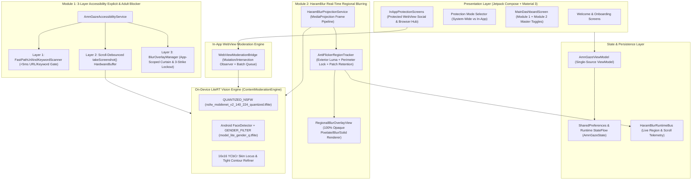

# AmnGaze — System Architecture & Technical Reference (`ARCHITECTURE.md`)

AmnGaze is an on-device, zero-knowledge Android visual content moderation and screen protection application powered by Android's `AccessibilityService` API, `MediaProjection` API, `WebView` DOM Moderation Bridge, and Google AI Edge LiteRT (`.tflite`). All inference, pixel sampling, and diagnostic logging execute 100% locally on-device with zero network transmission of screen frames or personal data.

---

## 1. High-Level System Architecture

---

## 2. Core Modules & File Responsibilities

| File | Responsibility |
| :--- | :--- |
| [MainActivity.kt](file:///home/habib/PROJECTS/Amni/AmnHaze-Android/app/src/main/java/com/amngaze/MainActivity.kt) | Application entry point; registers `CrashLogger` and mounts Jetpack Compose shell (`AmnGazeApp`). |
| [AmnGazeApp.kt](file:///home/habib/PROJECTS/Amni/AmnHaze-Android/app/src/main/java/com/amngaze/AmnGazeApp.kt) | Main Compose navigation host, onboarding flow, Module 1 dashboard settings, and theme integration. |
| [HaramBlurDashboardSection.kt](file:///home/habib/PROJECTS/Amni/AmnHaze-Android/app/src/main/java/com/amngaze/HaramBlurDashboardSection.kt) | Module 2 (HaramBlur) collapsible dashboard controls: 3-step permission strip, Target Gender (`Female`, `Male`, `Both`), Sensitivity (`Low`, `Medium`, `High`), Overlay Style (`Blur`, `Pixelate`, `Black`, `Gray`, `Skin`), and Effect Strength (`1..10`). |
| [InAppProtectionScreens.kt](file:///home/habib/PROJECTS/Amni/AmnHaze-Android/app/src/main/java/com/amngaze/InAppProtectionScreens.kt) | Dual protection mode selector, Connected Platforms manager, 4-digit Parental PIN gate, daily usage timers, and Protected In-App `WebView` Browser Hub. |
| [AmnGazeViewModel.kt](file:///home/habib/PROJECTS/Amni/AmnHaze-Android/app/src/main/java/com/amngaze/AmnGazeViewModel.kt) | Unified single-source `ViewModel` managing `StateFlow<AmnGazeState>` and synchronizing `SharedPreferences`. |
| [ContentModerationEngine.kt](file:///home/habib/PROJECTS/Amni/AmnHaze-Android/app/src/main/java/com/amngaze/ContentModerationEngine.kt) | On-device LiteRT inference engine, 3-crop whole-screen classifier, YCbCr skin-ratio estimator, face/grid/body regional detector, tight skin-contour refiner, and adjacent person box merger. |
| [ProtectionPipelineLogic.kt](file:///home/habib/PROJECTS/Amni/AmnHaze-Android/app/src/main/java/com/amngaze/ProtectionPipelineLogic.kt) | Layer 1 `FastPathUrlAndKeywordScanner` (80k adult domain `HashSet`), `StrikeLockoutManager` (rolling 5-minute 3-strike window), `FalsePositiveWhitelistManager` (child-safe 30s keyword-only snooze), and `ScrollDebounceController`. |
| [AmnGazeAccessibilityService.kt](file:///home/habib/PROJECTS/Amni/AmnHaze-Android/app/src/main/java/com/amngaze/AmnGazeAccessibilityService.kt) | Accessibility Service orchestrating Layer 1 fast-path URL/keyword checks, Layer 2 debounced `takeScreenshot()` captures (`180ms` settle + `900ms` lazy-load follow-up + `1,500ms` video heartbeat), and Layer 3 shield triggers. |
| [BlurOverlayManager.kt](file:///home/habib/PROJECTS/Amni/AmnHaze-Android/app/src/main/java/com/amngaze/BlurOverlayManager.kt) | App-scoped (`shieldedPackage`) whole-screen Curtain Shield (`TYPE_ACCESSIBILITY_OVERLAY`) with non-freezing touch flags and automatic launcher immunity dismissal. |
| [HaramBlurEngineLogic.kt](file:///home/habib/PROJECTS/Amni/AmnHaze-Android/app/src/main/java/com/amngaze/HaramBlurEngineLogic.kt) | Pure policy logic for HaramBlur candidate filtering (`shouldBlurCandidate`), bounding box expansion, spatial NMS merging, 100% opaque style/color math, and `AntiFlickerRegionTracker`. |
| [HaramBlurProjectionService.kt](file:///home/habib/PROJECTS/Amni/AmnHaze-Android/app/src/main/java/com/amngaze/HaramBlurProjectionService.kt) | Foreground `MediaProjection` service capturing screen frames, restoring clean reference patches outside locked regions, extracting `8x8` `previewPatch` bitmaps, and driving `RegionalBlurWindowManager`. |
| [RegionalBlurOverlayView.kt](file:///home/habib/PROJECTS/Amni/AmnHaze-Android/app/src/main/java/com/amngaze/RegionalBlurOverlayView.kt) | Non-touch-blocking (`FLAG_NOT_FOCUSABLE | FLAG_NOT_TOUCHABLE`) custom `View` rendering 100% solid opaque (`alpha = 255`) regional blur, gapless desaturated mosaic pixelation, and solid color shields with safe `previewPatch` lifecycle recycling. |
| [WebViewModerationBridge.kt](file:///home/habib/PROJECTS/Amni/AmnHaze-Android/app/src/main/java/com/amngaze/WebViewModerationBridge.kt) | JavaScript `MutationObserver` + `IntersectionObserver` bridge for In-App `WebView` moderation, synchronous clean-capture preparation, queued batch evaluation, and 100% opaque CSS backdrop filtering. |

---

## 3. On-Device AI Models & Inference Invariants

### 3.1 Model Routing & Preprocessing (`ContentModerationEngine.kt`)
1. **`ModerationModelType.QUANTIZED_NSFW` (`nsfw_mobilenet_v2_140_224_quantized.tflite`)**:
   - **Exclusive 5-Class Adult/NSFW Classifier**: `resolveAdultBlockerModelType()`, `classifyScreenMultiCrop()`, and `evaluateNsfwAndSkinBreakdown()` route exclusively to `QUANTIZED_NSFW` (`[0]=drawings, [1]=hentai, [2]=neutral, [3]=porn, [4]=sexy`).
   - **Elimination of `DEFAULT_NSFW` (`amn_gaze.tflite`) RGB Mismatch**: `amn_gaze.tflite` expects Caffe BGR `0..255` with VGG mean subtraction (`B - 104f, G - 117f, R - 123f`). It is never invoked with `[0, 1]` RGB normalization, and the secondary `DEFAULT_NSFW` fallback pass is removed from `classifyScreenMultiCrop()`. If `DEFAULT_NSFW` is ever invoked directly, `preprocessBitmapInternal()` applies Caffe BGR mean subtraction.
2. **`ModerationModelType.GENDER_FILTER` (`model_lite_gender_q.tflite`)**:
   - **Localized Face Gender Classifier (`128x128`)**: Used strictly for localized faces (`isFaceAnchor == true`) discovered by Android's `FaceDetector`.
   - **Never Invoked on Unanchored Grid Cells**: When `isGridCell == true` (no localized face inside the grid cell), `classifyCropForHaramBlur()` never calls `GENDER_FILTER` and never crops `headCrop`. Instead, it evaluates the full grid cell using `QUANTIZED_NSFW` and `estimateSkinPixelRatio()`, assigning `gender = inheritedGender ?: DetectedGender.UNKNOWN`.

### 3.2 Zero False-Positive UI & Text Guards (Module 1)
To guarantee that dark/light app UI, text pages, settings screens, and vector icons never false-trigger Module 1:
1. **Pre-Inference Skin Short-Circuit (`classifySingleCropInternal`)**:
   - Computes `val skinRatio = estimateSkinPixelRatio(cropBitmap)` on a `16x16` RGB + YCbCr human skin locus before running LiteRT inference.
   - If `skinRatio < 0.045f`, short-circuits immediately and returns `SAFE (confidence = 0f)` without invoking LiteRT.
2. **5-Class NSFW Scoring Gates (`computeFiveClassNsfwScore`)**:
   - **Skin & Media Presence Gate**: If `skinRatio < 0.05f` and `pornProb < 0.82f`, returns `0.0f` (`SAFE`).
   - **Safe UI / Text Guard**: If `(neutralProb + drawingsProb) >= 0.50f` and `pornProb < 0.82f`, returns `0.0f` (`SAFE`).
   - **False Hentai Spike Suppression**: Includes `hentaiProb` only when `hentaiProb >= 0.65f && neutralProb < 0.20f && skinRatio >= 0.08f`; otherwise `explicitScore = pornProb`.
   - **Optional Sexy Weight (`0.85x`)**: When `includeSexyScore == false`, returns `explicitScore` only (requiring `skinRatio >= 0.08f`).
3. **Sensitivity Slider Threshold Curve (`confidenceThresholdForSensitivity`)**:
   - `20%` (Maximum Strict): `0.78f`
   - `25%` (Strict): `0.74f`
   - `50%` (Balanced / Default): `0.60f`
   - `75%` (Aggressive): `0.48f`
   - `95%` (Maximum): `0.38f`

---

## 4. Module 2: HaramBlur Regional Detection & 100% Opaque Rendering

### 4.1 Dual-Case Candidate Filtering (`HaramBlurFilterLogic.shouldBlurCandidate`)
1. **Mandatory Explicit Rule**: Always blurs any candidate where `explicitPornNudityConfidence >= max(0.55f, sensitivity.threshold)`.
2. **Case 1 — Localized Face Anchor (`candidate.gender != DetectedGender.UNKNOWN`)**:
   - `Target == FEMALE`: Blurs if `gender == FEMALE` and `effectiveConf >= max(0.62f, sensitivity.threshold)`. Strictly never blurs `DetectedGender.MALE`.
   - `Target == MALE`: Blurs if `gender == MALE` and `effectiveConf >= max(0.62f, sensitivity.threshold)`. Strictly never blurs `DetectedGender.FEMALE`.
   - `Target == BOTH`: Blurs if `effectiveConf >= max(0.58f, sensitivity.threshold)`.
3. **Case 2 — Unanchored Grid Cell or Body Region (`candidate.gender == DetectedGender.UNKNOWN`)**:
   - Evaluates `bodyVisualScore = explicitPornNudityConfidence + revealingSkinConfidence`.
   - Blurs when `bodyVisualScore >= max(0.42f, sensitivity.threshold)` **AND** (`revealingSkinConfidence >= 0.25f || explicitPornNudityConfidence >= 0.35f`).
   - Ensures lingerie/body tiles without a visible frontal face are blurred immediately while walls, curtains, doors, and background tiles (`bodyVisualScore ~ 0.0f`) are never blurred.

### 4.2 Tight Skin-Contour Refinement & Single-Person Box Unification
- **Tight Contour Bounding Box (`computeTightSkinBoundingBox`)**: Instead of returning raw `1/3 x 1/3` grid rectangles that cover background walls, computes the tight `[minX, minY, maxX, maxY]` bounding box of skin/foreground samples on the `16x16` sample grid inside the triggered cell, padded by `+8%`.
- **Single-Person Adjacent Merging (`mergeAdjacentPersonBoxes`)**: When `gridCellsTriggered <= 3`, merges vertically or horizontally adjacent skin/body/face boxes (`IoU >= 0.15f` or shared edge overlap `>= 0.50f`) into a single unified bounding box over the subject.

### 4.3 100% Solid Opaque Rendering & Bitmap Lifecycle (`RegionalBlurOverlayView` & `HaramBlurProjectionService`)
- **Zero See-Through (`alpha = 255`)**: `computeOverlayAlpha(1..10)` returns `255` across all strength levels `1..10`, and `borderPaint` uses solid opaque `Color.argb(255, 71, 85, 105)` with zero vertical stripes or translucent gaps.
- **Clean Reference Frame Protection**: `HaramBlurProjectionService.processLatestFrame()` clips out all `currentLockedRects` via `clipOutRect` before copying `frameBitmap` into `lastCleanFrameBitmap` so rendered blur boxes are never burned into the clean reference frame.
- **Locked Preview Patch Retention & Safe Recycling**:
  - Each `TrackedBlurRegion` carries an `8x8` downscaled `previewPatch: Bitmap?` extracted from `lastCleanFrameBitmap`.
  - Stationary locked regions (`reg.id in lockedRegionIds`) retain their existing unrecycled `previewPatch` (`regionTracker.replaceActiveRegions(regionsWithPatches)`).
  - `RegionalBlurOverlayView.updateBoxes(newBoxes)` recycles an `oldPatch` only when `newBoxes.none { it.previewPatch === oldPatch }`, and `onDraw(canvas)` guards all bitmap draws with `if (patch != null && !patch.isRecycled)`.
  - **`PIXELATE` Style**: Renders a gapless (`gap = 0f`) mosaic grid (`12dp` at strength 1 up to `38dp` at strength 10) over a `255` opaque `#FF0F172A` backing rect, desaturating skin pixels (`ContentModerationEngine.isSkinPixel`) into a dark-slate palette.
  - **`BLUR` Style**: Draws the `8x8` patch upscaled with `Paint.FILTER_BITMAP_FLAG` plus a dark frosted tint (`Color.argb(210, 20, 28, 42)`) over a `255` opaque `#FF1E293B` backing rect.
  - **`BLACK`, `GRAY`, `SKIN` Styles**: Draws 100% solid opaque rounded rectangles (`#FF000000`, `#FF64748B`, `#FFD4A373`).
  - **In-App `WebView` DOM Overlay (`WebViewModerationBridge.kt`)**: Applies `filter: blur(28px) brightness(0.22) contrast(0.4)` paired with an opaque `[data-amngaze-verdict="BLURRED"]::before` backdrop (`#1E293B`).
